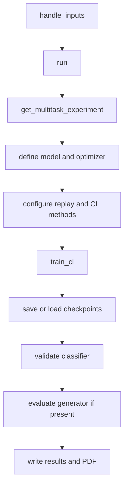

# Developer Guide

This document explains how a continual-learning run is organized and where to modify behavior. The main flow is implemented in `main_cl.py`; the rest of this guide follows that script chronologically through setup, training, replay, saving/loading, testing, and plotting.

## 1. Entry point and command-line flow

`main_cl.py` is the primary entry point:

1. `handle_inputs()` creates the argument parser and combines option groups from `options.py`.
2. `options.set_defaults()` applies experiment-specific defaults.
3. `options.check_for_errors()` validates incompatible selections.
4. `run(args, verbose=True)` builds the experiment and executes training/evaluation.

Useful places:

- Add or change a CLI option: `options.py`, usually the appropriate `add_*_options()` function plus `set_defaults()` and `check_for_errors()`.
- Change which options describe a method: `param_stamp.py`, so that model/result names remain unique.
- Run many configurations or collect comparison figures: scripts named `compare_*.py` and `create_figures.sh`.
- Run a standalone pretraining experiment: `main_pretrain.py`.

The central execution flow is:

## 2. Data preparation

The data stage is at the start of `run()`.

### Dataset loading and task construction

`data/load.py::get_multitask_experiment()` returns:

- `train_datasets`: one training `Dataset` per task;
- `test_datasets`: one test `Dataset` per task;
- `config`: image size, channels, class count, normalization, and other dataset metadata;
- `classes_per_task`: number of classes/domains represented by a task.

It uses dataset implementations and wrappers from:

- `data/load.py`: built-in dataset loading and task splitting;
- `data/HITS.py::HITSDataset` and `DataHandler`: HITS-specific loading and task definitions;
- `data/manipulate.py::SubDataset`: selects particular labels;
- `data/manipulate.py::TransformedDataset`: applies input or label transformations, used for permutations;
- `data/manipulate.py::ReducedDataset`: limits dataset size.

Modify these locations for:

- a new benchmark or data format: add a branch to `get_multitask_experiment()` and update `DATASET_CONFIGS` in `data/load.py`;
- a new HITS task split or task order: `data/HITS.py` task definitions and `main_cl.py` task-order handling;
- new transforms or augmentations: `data/load.py`, `data/manipulate.py`, and `AVAILABLE_TRANSFORMS`/dataset configuration;
- a new collate or data-loader behavior: `utils.py::get_data_loader()` and `label_squeezing_collate_fn()`.

`utils.get_data_loader()` is used by the training loop and evaluation code, so changing its default `drop_last`, CUDA movement, or collate behavior affects both phases.

## 3. Model construction

### Factory functions

`define_models.py` is the model-construction layer:

- `define_classifier()` creates a `models.classifier.Classifier`;
- `define_autoencoder()` creates a `models.vae.AutoEncoder`;
- `init_params()` resets, custom-initializes, or loads pretrained convolutional parameters.

`main_cl.run()` chooses the main model as follows:

- `args.feedback == True`: `define_autoencoder()`; the VAE is also the classifier under replay-through-feedback;
- otherwise: `define_classifier()`.

For separate generative replay, `run()` creates a second `AutoEncoder` by calling `define_autoencoder(..., generator=True)`.

Modify these locations for:

- constructor arguments or architecture defaults: `define_models.py`;
- classifier structure: `models/classifier.py::Classifier`;
- VAE encoder, decoder, prior, gating, or sample behavior: `models/vae.py::AutoEncoder`;
- convolutional blocks: `models/conv/nets.py` and `models/conv/layers.py`;
- fully connected blocks: `models/fc/nets.py` and `models/fc/layers.py`;
- parameter or bias initialization: `define_models.py::init_params()` and `utils.py::weight_reset()`, `weight_init()`, `bias_init()`.

### Optimizers

Both the main model and optional separate generator receive an Adam optimizer in `main_cl.run()`:

- main model: `model.optimizer` over `model.parameters()` with `args.lr`;
- separate generator: `generator.optimizer` over `generator.parameters()` with `args.lr_gen` or `args.lr`.

Change optimizer choice or optimizer groups in `main_cl.py`, and change per-batch update behavior in `train_a_batch()`.

## 4. The continual-learning base class

`models/cl/continual_learner.py::ContinualLearner` is the shared abstraction inherited by both `Classifier` and `AutoEncoder`.

It owns configuration and implementation for:

- XdG/task masks;
- Elastic Weight Consolidation (EWC);
- Synaptic Intelligence (SI);
- replay target mode (`hard` or `soft`) and knowledge-distillation temperature;
- device and CUDA helper methods.

Important method groups:

- `define_XdGmask()`, `apply_XdGmask()`, `reset_XdGmask()`;
- `estimate_fisher()`, `ewc_loss()`;
- `update_omega()`, `surrogate_loss()`.

The concrete models must implement `forward()` and `train_a_batch()` because these contain the actual batch losses and optimization steps.

### Allocations configured before training

`main_cl.run()` translates CLI options into model attributes:

- EWC: `ewc_lambda`, `fisher_n`, `online`, `gamma`;
- SI: `si_c`, `epsilon`;
- XdG: `define_XdGmask(gating_prop=...)`;
- replay target: `replay_targets` and `KD_temp`.

To modify post-task behavior, start in `train_cl()`; to modify loss calculation or Fisher/SI storage, start in `ContinualLearner` or the concrete model.

## 5. Chronological multi-task training

### `train_cl()` orchestrates tasks

`train.py::train_cl()` is the main training timeline. It loops once per task and for each batch:

1. Creates a data loader and fetches current-task images and labels.
2. Adjusts labels for task-incremental learning.
3. Collects a replay batch, if replay is active.
4. Obtains replay targets from a frozen copy of the previous model.
5. Calls `model.train_a_batch()`.
6. Optionally calls `generator.train_a_batch()`.
7. Fires loss/evaluation/sample callbacks.
8. After the task: updates EWC Fisher information or SI importance estimates.
9. Deep-copies the updated model as the replay source for subsequent tasks.

The replay source is intended to remain frozen. The live and previous model roles are:

- `model`: current trainable model;
- `previous_model`: deep copy used to generate soft/hard targets;
- `generator`: live separate VAE;
- `previous_generator`: deep copy of the live VAE, or `previous_model` for feedback replay.

### Replay modes

The replay branch in `train_cl()` is determined by `replay_mode`:

- `none`: only current-task data;
- `current`: replay samples of current-task inputs with predictions from the previous model (LwF-style distillation);
- `generative`: generate replay samples with the previous generator;
- `offline`: concatenate datasets or sample each task separately according to scenario.

Modify replay mechanics in `train.py::train_cl()`:

- generated or current replay sampling:
  - `Generative` and `Current` branches;
- replay target calculation:
  - the `previous_model.classify(...)` block;
- replay target type:
  - `model.replay_targets = "hard" | "soft"` configured in `main_cl.run()`;
- replay batch sizes:
  - `args.batch_replay` and `args.batch`;
- generator or current-batch proportions:
  - `rnt` and the weighted current/replay losses in `train_a_batch()`.

For replay-through-feedback (`args.feedback`), the VAE itself acts as the main model and replay generator. For separate generator replay, `generator` and `model` are optimized independently.

### The classifier batch update

`models/classifier.py::Classifier.train_a_batch()` performs:

1. Optional XdG mask selection.
2. Current-batch forward pass through convolutional and fully connected layers.
3. Cross-entropy loss for current data.
4. Replay forward pass with replayed hidden or image inputs.
5. Hard replay cross-entropy or soft knowledge distillation.
6. XdG, EWC, and SI losses.
7. Backpropagation and `optimizer.step()`.

Change classifier prediction loss or replay weighting here. Shared replay-loss utilities are in `models/utils/loss_functions.py`, including KD and weighted averaging.

### The VAE batch update

`models/vae.py::AutoEncoder.train_a_batch()` performs:

1. Optional hidden-feature preprocessing if replay is internal.
2. Encoder and reparameterization.
3. Decoder reconstruction.
4. Optional classification loss.
5. Reconstruction, variational/KL, prediction, and replay-distillation losses.
6. Replay weighting and regularization losses.
7. Backpropagation and `optimizer.step()`.

Related methods:

- `encode()` and `decode()` define the VAE forward flow;
- `forward(full=True)` combines encode/decode/classification;
- `loss_function()` combines reconstruction, variational, prediction, and distillation losses;
- `calculate_recon_loss()` and `calculate_variat_loss()` implement individual losses;
- `sample()` creates replay images or hidden representations;
- `calculate_recon_error()` and `estimate_loglikelihood()` provide generative evaluation.

Change a VAE loss in `loss_function()`, a prior or KL term in `calculate_variat_loss()`, and a sampling rule in `sample()`.

## 6. End of task: regularization updates

At the end of `train_cl`'s task loop:

- EWC calls `model.estimate_fisher(train_dataset, allowed_classes=...)` and stores Fisher and parameter snapshots as buffers.
- SI calls `model.update_omega(W, model.epsilon)` using running gradient/parameter-change estimates collected during that task.
- replay state is updated by copying the model or generator.

To change post-task sample selection for EWC, modify `estimate_fisher()` or the allowed-class calculation in `train_cl()`. To change SI accumulation, modify the `W`/`p_old` update in `train_cl()` and `update_omega()`.

## 7. Callbacks during training

Callbacks are created in `main_cl.run()` and invoked from `train_cl()`.

`eval/callbacks.py` contains callback factories:

- `_solver_loss_cb()`: classifier loss and progress-bar updates;
- `_VAE_loss_cb()`: VAE loss components and progress-bar updates;
- `_eval_cb()`: calls accuracy evaluation periodically;
- `_latent_space_cb()`: visualizes extracted features;
- `_sample_cb()`: visualizes reconstructions and samples.

`train_cl()` fires callbacks after `train_a_batch()`. Add a callback if you need a custom metric at every batch or only at task boundaries.

### Callback wiring: exact flow

The callback pipeline is:

1. `main_cl.run()` instantiates callback functions from `eval/callbacks.py`.
2. `train.train_cl()` receives callback lists (`loss_cbs`, `eval_cbs`, `sample_cbs`).
3. Inside the inner batch loop, `train_cl()` executes:
   - loss callbacks after every optimization step;
   - eval callbacks based on their internal `if iteration % log == 0` logic;
   - sample callbacks for generator outputs.

This means metric scheduling belongs in callback code, not in the trainer loop.

### Where to modify callback behavior

- Add a new periodic metric callback:
  - create a new factory in `eval/callbacks.py` (similar to `_eval_cb`);
  - call evaluation logic in `eval/evaluate.py`;
  - append your callback to `eval_cbs` in `main_cl.py`.
- Change logging cadence:
  - use `log` argument when creating callbacks in `main_cl.py`;
  - or adjust callback internals in `eval/callbacks.py`.
- Restrict metric computation to end-of-task only:
  - set callback `log=args.iters` as done for `eval_cb_full` and `latent_space_cb`.
- Add Visdom traces:
  - call `visual.visdom.visualize_scalars(...)` in your callback.
- Add PDF figures:
  - store metric in `progress_dict` during callbacks, then render in the PDF section of `main_cl.py` using `visual/plt.py`.

### Practical pattern for new metrics

For a new continual-learning metric (for example forgetting), use this division:

- Computation logic: `eval/evaluate.py`.
- Trigger/scheduling: `eval/callbacks.py`.
- Registration in run: `main_cl.py` callback lists.
- Persistence and plotting: `progress_dict` + save/load in `main_cl.py` + PDF plotting section.

Callbacks write to:

- Visdom through `visual/visdom.py`;
- PDF figures through `evaluate.visual.plt` or `visual/plt.py`;
- progress dictionaries in `eval/evaluate.py`.

For a change to callback frequency, inspect `options.py` log options and `set_defaults()` (`acc_log`, `loss_log`, `sample_log`, `log_per_task`).

## 8. Checkpoint saving and loading

Saving occurs after training, loading occurs instead of training when `args.train == False`.

- `utils.save_checkpoint()` stores `model.state_dict()`;
- `utils.load_checkpoint()` restores a state and recreates missing SI/EWC buffers;
- model and parameter names come from `model.name` and `param_stamp.py`.

Main/generator checkpoint names are built in `main_cl.run()` using the parameter stamp. Add a saved field by making it part of `model.state_dict()` (typically a registered buffer or parameter) rather than by writing it separately in `main_cl.py`.

## 9. Testing and evaluation

### Final classifier accuracy

After training/loading, `main_cl.run()` evaluates each test dataset with `evaluate.validate()`:

- sets the model to `eval()` mode;
- optionally applies the XdG mask;
- restricts logits to allowed task/class indices;
- reports accuracy per task and average accuracy;
- writes the average to `store/results/acc-<param_stamp>.txt`.

For changes to a single accuracy calculation, modify `eval/evaluate.py::validate()`. For periodic accuracies during training, modify `test_accuracy()` and `_eval_cb()`.

### Adding new CL metrics (example: forgetting)

If you want to add forgetting, the most maintainable place is around `evaluate.test_accuracy()`, because it already computes task-wise accuracies across tasks-so-far.

Recommended implementation steps:

1. Extend progress structure in `eval/evaluate.py::initiate_progress_dict()`.
  - Add keys such as:
    - `best_acc_per_task`
    - `forgetting_per_task`
    - `forgetting_avg`
2. Update `eval/evaluate.py::test_accuracy()`.
  - Reuse the `accs` list already computed there.
  - Update running best accuracy per task:
    - `best_acc_per_task[t] = max(best_acc_per_task[t], accs[t])`
  - Compute per-task forgetting at current time:
    - `F_t = best_acc_per_task[t] - accs[t]`
  - Aggregate forgetting over previously seen tasks and append to `forgetting_avg`.
3. Keep train-time trigger in callbacks.
  - No trainer changes needed if metric is computed inside `test_accuracy()` called by `_eval_cb()`.
4. Save and reload automatically.
  - `main_cl.py` already saves/loads `progress_dict`; new keys are persisted automatically.
5. Add visualization.
  - During training: add a Visdom line in callback or in `test_accuracy()`.
  - In PDF: add extra plot(s) in `main_cl.py` using `visual/plt.py::plot_lines(...)`.
6. Add final text output file if desired.
  - In `main_cl.py` final evaluation section, write `forgetting-<param_stamp>.txt` in `args.r_dir`.

Notes:

- In many CL papers, average forgetting is computed over old tasks only, not including the current just-learned task. Match your chosen definition explicitly in code comments.
- For class-incremental scenario, ensure the same `allowed_classes` convention is used for both best and current accuracies.

Minimal formula reminder:

$$
F_t^{(k)} = \max_{i \le k} a_{t,i} - a_{t,k}, \quad t < k
$$

where $a_{t,k}$ is accuracy on task $t$ after learning task $k$.

### Generator evaluation

The generator block in `main_cl.run()` runs only for feedback or separate generative replay with CIFAR-100 in the class scenario:

- marginal log-likelihood: `AutoEncoder.estimate_loglikelihood()`;
- reconstruction error: `AutoEncoder.calculate_recon_error()`;
- generated-sample embedding and Inception-like classifier evaluation;
- Inception Score, FID, and precision/recall through `eval/fid.py` and `eval/precision_recall.py`.

This block uses an independently loaded pretrained/evaluation classifier checkpoint. It is mainly implemented in `main_cl.run()` and `eval/fid.py`/`eval/precision_recall.py`.

### Training-history and plots

`evaluate.initiate_progress_dict()` creates the in-memory training-history structure. `evaluate.test_accuracy()` fills it through training callbacks.

In the PDF phase in `main_cl.run()`:

- task and average accuracies come from `progress_dict`;
- final generated samples use `evaluate.show_samples()`;
- reconstructions use `evaluate.show_reconstruction()`;
- precision/recall plots use `visual/plt.py::plot_pr_curves()`.

If you add new metric series to `progress_dict`, this is the section where you should add matching figure generation logic.

## 10. Where to make common changes

| Desired change | Start here |
|---|---|
| CLI flag or experiment default | `options.py` |
| Dataset/task construction | `data/load.py`, `data/HITS.py`, `data/manipulate.py` |
| Main architecture or generator architecture | `define_models.py`, `models/classifier.py`, `models/vae.py` |
| Conv/Fc internals | `models/conv/`, `models/fc/` |
| Main training loop and replay sampling | `train.py::train_cl()` |
| Classifier one-batch loss/update | `models/classifier.py::Classifier.train_a_batch()` |
| VAE one-batch loss/update | `models/vae.py::AutoEncoder.train_a_batch()` |
| Replay target loss | `models/utils/loss_functions.py` |
| EWC/SI/XdG state or losses | `models/cl/continual_learner.py` |
| Callback/periodic metric | `eval/callbacks.py` |
| Final accuracy computation | `eval/evaluate.py::validate()` |
| Per-task / over-time CL metrics (forgetting, BWT, FWT) | `eval/evaluate.py::test_accuracy()` and `initiate_progress_dict()` |
| End-of-task-only metric updates | callback log schedule in `main_cl.py` + `eval/callbacks.py` |
| Training-time metric plotting (Visdom) | `eval/callbacks.py` and `visual/visdom.py` |
| PDF metric plots | PDF section in `main_cl.py` + `visual/plt.py` |
| Persist metric history | `progress_dict` creation in `eval/evaluate.py` + save/load in `main_cl.py` |
| Write dedicated metric text files | final evaluation block in `main_cl.py` |
| Sampling/reconstruction visualization | `eval/evaluate.py::show_samples/reconstruction` |
| Checkpoint format/save/load | `utils.py::save_checkpoint/load_checkpoint` |
| Result filename and model name | `param_stamp.py` |
| Output plots | `visual/plt.py`, `visual/visdom.py` |
| End-to-end experiment orchestration | `main_cl.py::run()` |

### Quick checklist when adding a metric

Use this to avoid missing one integration point:

1. Add storage keys in `initiate_progress_dict()`.
2. Compute and append metric values in `test_accuracy()`.
3. Ensure callback path triggers that computation (`_eval_cb` schedule).
4. Plot in Visdom (optional) and PDF (optional).
5. Persist via existing `utils.save_object(progress_dict, ...)` path.
6. Add final scalar output file in `main_cl.py` if you need script-friendly summary values.

## 11. Important scenario distinctions

Some code branches treat the continual-learning scenario differently:

- Task-incremental (`task`): labels are shifted to a task-local range and evaluation selects a task-specific output block.
- Domain-incremental (`domain`): labels remain shared across tasks and the replayed or current data is used by the same output head.
- Class-incremental (`class`): outputs accumulate over seen classes and previous-class logits are extended or padded as needed.

Keep these conventions in mind when changing labels, active-class lists, replay targets, priors, decoder gates, or evaluation code. In particular, `active_classes`, `allowed_classes`, `y - classes_per_task*(task-1)`, and logits slicing are not cosmetic details: they control how task-local targets map to the model output.
